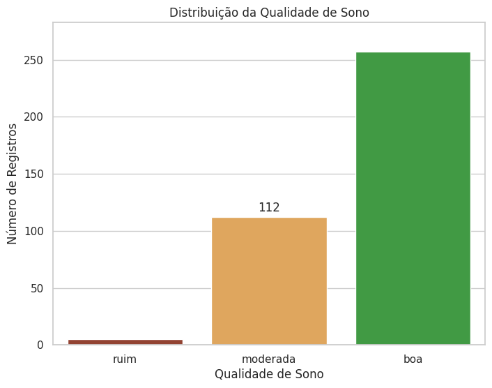
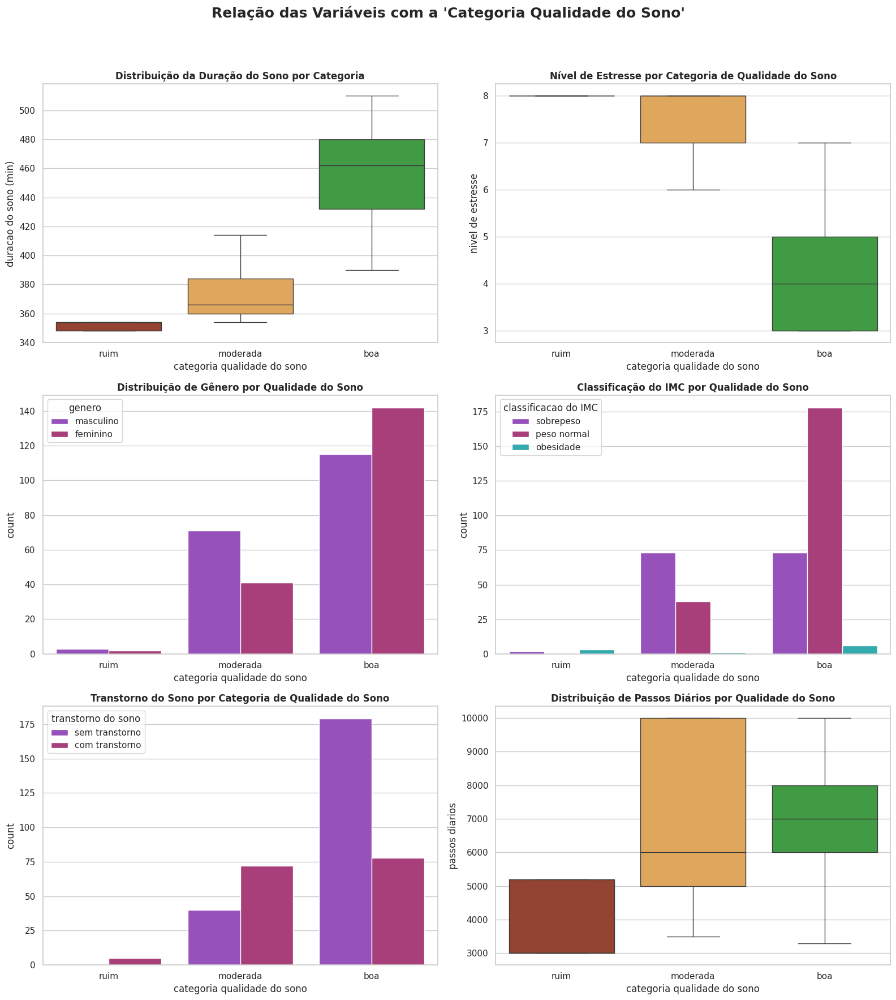
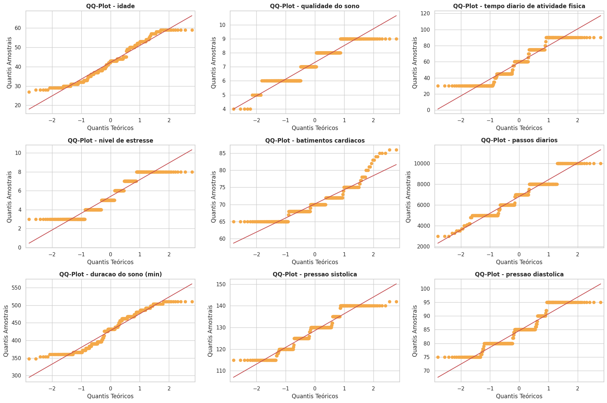
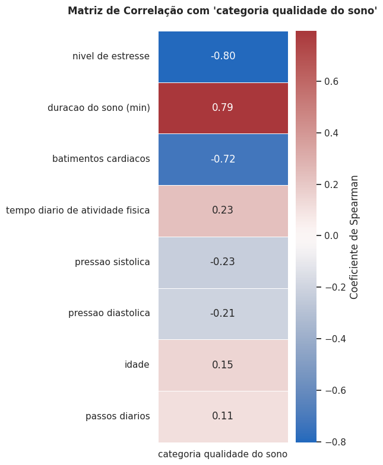
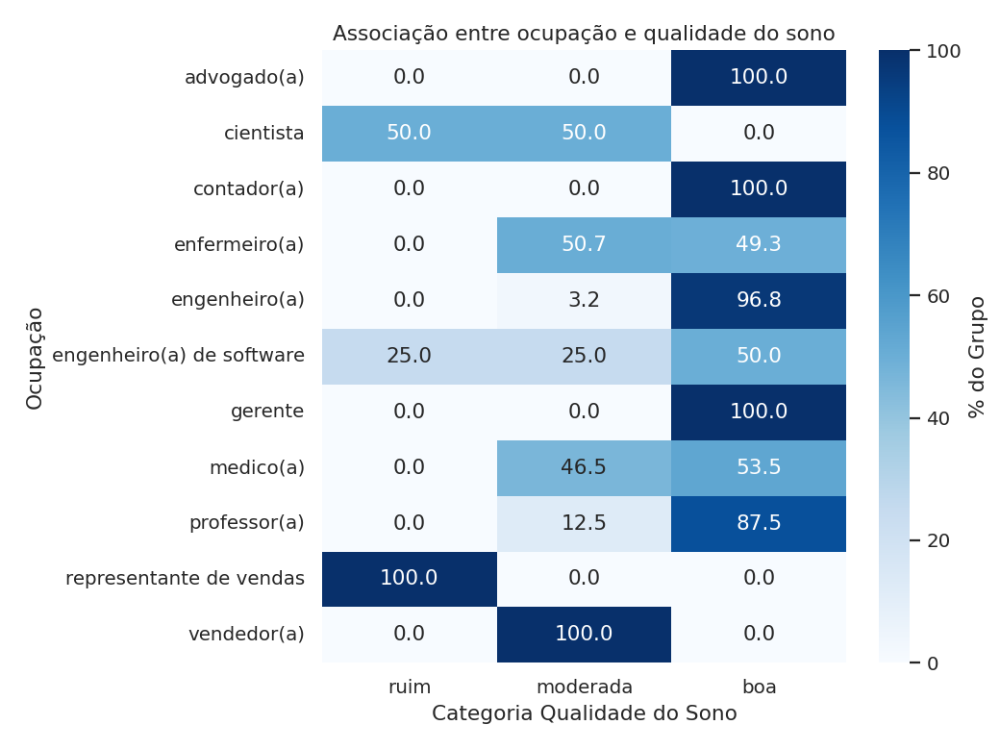
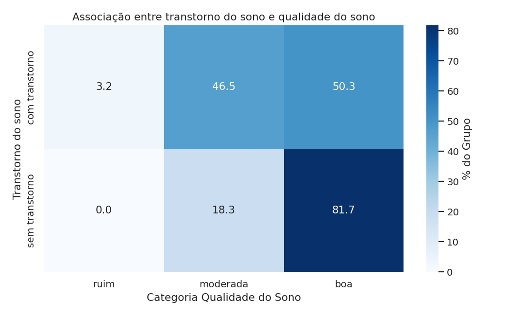
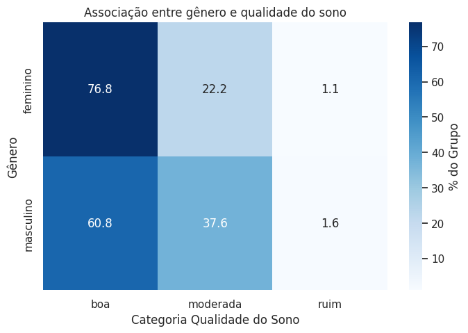
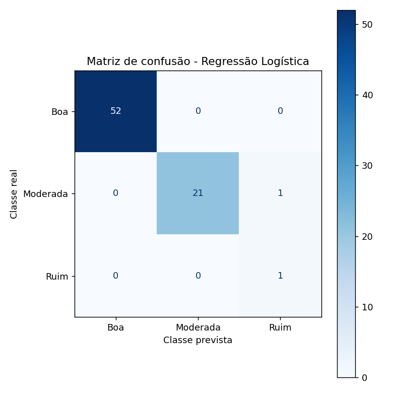

# Desafio 7 - Desafio Final

Sétimo e último desafio prático desenvolvido pela **Squad Ada Lovelace** durante o **Bootcamp Data Analytics**, promovido pela **WoMakersCode**.

O objetivo deste desafio foi reunir tudo o que aprendemos no bootcamp (limpeza e preparação de dados, análise exploratória, testes de associação e correlação, visualização e modelagem) para construir um modelo de machine learning que classifica a qualidade do sono de uma pessoa a partir de variáveis de estilo de vida e saúde.

## Sobre o desafio

Uma empresa de saúde digital deseja desenvolver um sistema de alertas para pessoas com potencial de **risco de má qualidade do sono**. Para isso, a squad recebeu os dados de um estudo com adultos, que tiveram seus hábitos e padrões de sono analisados.

A base contém **374 pessoas** e, após o tratamento, **16 colunas**: gênero, idade, ocupação, nota de qualidade do sono, tempo diário de atividade física, nível de estresse, classificação do IMC, batimentos cardíacos, passos diários, transtorno do sono, duração do sono, pressão arterial e as classificações criadas pela squad.

O desafio pedia que a qualidade do sono fosse classificada em três categorias, a partir da nota de 0 a 10 do estudo:

| Categoria | Nota | Pessoas na base |
|---|:---:|:---:|
| **Ruim** | 0 a 4 | 5 (1,3%) |
| **Moderada** | 5 a 6 | 112 (29,9%) |
| **Boa** | 7 a 10 | 257 (68,7%) |

Além do modelo, o desafio propôs três perguntas de investigação sobre os dados, respondidas ao longo do notebook.

O tratamento e a preparação inicial da base foram feitos em um notebook separado, que pode ser consultado [aqui](https://colab.research.google.com/github/squad-ada-lovelace/Desafio_07-Desafio-final/blob/claudia/notebook/notebook_claudia.ipynb).

É possível acessar o arquivo principal em Jupyter Notebook clicando [aqui](/Ada_Lovelace_Desafio_Final___Bootcamp_Data_Analytics_2026_1.ipynb).

## O que foi feito

### Tratamento e preparação (notebook separado)

- **Tradução** dos nomes das colunas e dos registros para o português.
- Verificação de **nulos e duplicados**. Apenas a coluna de transtorno do sono tinha nulos (219 registros). Após verificação, a squad entendeu que eles indicavam pessoas **sem transtorno**, e a coluna passou a ter duas categorias: "com transtorno" e "sem transtorno".
- Criação da coluna de **duração do sono em minutos**, substituindo a anterior.
- Separação da pressão arterial em **sistólica** e **diastólica**, e criação da **classificação da pressão** (normal, pré-hipertensão e hipertensão estágio 1).
- Criação da **categoria de qualidade do sono** (ruim, moderada e boa), conforme os intervalos do desafio.

### Notebook principal

O notebook segue essa estrutura:

1. **Análise exploratória**: estatísticas descritivas das variáveis numéricas e categóricas, verificação de nulos, duplicados e outliers (método IQR).
2. **Visualizações**: relação de cada variável com a categoria de qualidade do sono.
3. **Associação das variáveis categóricas** com a qualidade do sono: teste do qui-quadrado e V de Cramér.
4. **Correlação das variáveis numéricas**: QQ plots para checar a normalidade e correlação de Spearman.
5. **Análise por faixas etárias**: agrupamento das idades e V de Cramér.
6. **Respostas às perguntas do desafio.**
7. **Modelagem**: regressão logística com pipeline de pré-processamento e análise crítica dos resultados.

### Decisões da squad

- **Outliers de batimentos cardíacos mantidos:** foram detectados outliers, mas a squad os manteve, pois frequências de até 86 bpm estão dentro da faixa normal de repouso (60 a 100 bpm) e representam variações biológicas reais, e não erros.
- **Spearman em vez de Pearson:** os QQ plots mostraram que as variáveis numéricas não seguem uma distribuição normal.
- **Faixas etárias agrupadas:** nas faixas de 5 anos, algumas ficaram com pouquíssimas pessoas (a de 24 a 28 anos tem só 6). Por isso foram agrupadas em três faixas mais representativas: 24 a 34, 35 a 44 e 45 anos ou mais.

## Perguntas respondidas

| # | Pergunta | Resumo do código | Resposta |
|---|----------|-------------------|----------|
| 1 | Quais variáveis mais se correlacionam com a qualidade do sono? | `chi2_contingency()` + V de Cramér para as categóricas e `corr('spearman')` para as numéricas | Ocupação (V de Cramér = 0,72) entre as categóricas; nível de estresse (-0,80), duração do sono (0,79) e batimentos cardíacos (-0,72) entre as numéricas |
| 2 | Existem diferenças de padrão entre homens e mulheres? E entre faixas etárias? | Tabelas de contingência normalizadas, `pd.cut()` para as faixas etárias, qui-quadrado e V de Cramér | Sim nos dois casos. Mulheres têm mais sono "bom" (76,8% contra 60,8%); jovens de 24 a 34 anos dormem pior (43,9% com sono "bom") |
| 3 | Quais variáveis mais impactam positiva e negativamente a qualidade do sono? | Análise conjunta dos testes e das tabelas de contingência | Positivo: maior duração do sono e ausência de transtorno. Negativo: estresse alto, frequência cardíaca de repouso elevada e presença de transtorno do sono |

### Associação das variáveis categóricas com a qualidade do sono

| Variável | Qui-quadrado | P-valor | V de Cramér | Força da associação |
|---|:---:|:---:|:---:|:---:|
| Ocupação | 407,38 | < 0,001 | 0,72 | Muito forte |
| Transtorno do sono | 44,18 | < 0,001 | 0,34 | Moderada |
| Gênero | 11,03 | 0,004 | 0,16 | Fraca |

### Correlação das variáveis numéricas (Spearman)

| Variável | Correlação | Leitura |
|---|:---:|---|
| Nível de estresse | -0,80 | Forte e negativa: mais estresse, pior sono |
| Duração do sono | 0,79 | Forte e positiva: mais horas dormidas, melhor classificação |
| Batimentos cardíacos | -0,72 | Forte e negativa: frequência de repouso mais alta, pior sono |
| Pressão sistólica | -0,23 | Fraca |
| Atividade física diária | 0,23 | Fraca |
| Pressão diastólica | -0,21 | Fraca |
| Idade | 0,15 | Irrelevante |
| Passos diários | 0,11 | Irrelevante |

### Qualidade do sono por ocupação

| Ocupação | Pessoas na base | Boa | Moderada | Ruim |
|---|:---:|:---:|:---:|:---:|
| Advogado(a) | 47 | 100% | 0% | 0% |
| Contador(a) | 37 | 100% | 0% | 0% |
| Engenheiro(a) | 63 | 96,8% | 3,2% | 0% |
| Professor(a) | 40 | 87,5% | 12,5% | 0% |
| Médico(a) | 71 | 53,5% | 46,5% | 0% |
| Enfermeiro(a) | 73 | 49,3% | 50,7% | 0% |
| Vendedor(a) | 32 | 0% | 100% | 0% |
| Engenheiro(a) de software | 4 | 50% | 25% | 25% |
| Cientista | 4 | 0% | 50% | 50% |
| Representante de vendas | 2 | 0% | 0% | 100% |
| Gerente | 1 | 100% | 0% | 0% |

> As ocupações com poucas pessoas (gerente, representante de vendas, cientista e engenheiro de software) têm percentuais pouco confiáveis: um único registro muda a porcentagem de forma drástica. Por isso, os resultados mais sólidos são os das ocupações com dezenas de pessoas.

### Qualidade do sono por gênero, faixa etária e transtorno

| Grupo | Pessoas | Boa | Moderada | Ruim |
|---|:---:|:---:|:---:|:---:|
| Feminino | 185 | 76,8% | 22,2% | 1,1% |
| Masculino | 189 | 60,8% | 37,6% | 1,6% |
| 24 a 34 anos | 82 | 43,9% | 50,0% | 6,1% |
| 35 a 44 anos | 168 | 76,8% | 23,2% | 0% |
| 45 anos ou mais | 124 | 74,2% | 25,8% | 0% |
| Sem transtorno do sono | 219 | 81,7% | 18,3% | 0% |
| Com transtorno do sono | 155 | 50,3% | 46,5% | 3,2% |

A associação com a faixa etária é moderada (V de Cramér = 0,24) e **não é linear**: o principal contraste está entre os 24 a 34 anos e os grupos a partir dos 35, que têm distribuições parecidas entre si.

## Modelagem

### Preparação

- **Variável alvo:** categoria de qualidade do sono (ruim, moderada ou boa).
- **Variáveis removidas:** ID da pessoa, nota de qualidade do sono (a categoria é derivada dela, o que causaria vazamento de informação), duração do sono e pressões sistólica e diastólica (a categoria de pressão foi mantida).
- **Variáveis usadas:** idade, atividade física, nível de estresse, batimentos cardíacos e passos diários (numéricas, padronizadas com `StandardScaler`), e gênero, ocupação, IMC, transtorno do sono e classificação da pressão (categóricas, codificadas com `OneHotEncoder`).
- **Divisão treino/teste:** 80% e 20% (299 e 75 registros), com `stratify` para manter a proporção das classes nos dois conjuntos.
- **Desbalanceamento:** como a classe "ruim" tem só 5 registros, foi usado `class_weight='balanced'`, que faz o modelo dar mais peso aos erros nas classes com menos exemplos.
- **Pipeline:** pré-processamento e modelo no mesmo `Pipeline`, o que evita vazamento de informação do teste para o treino.

### Resultado: Regressão Logística

| Classe | Precisão | Revocação | F1-Score | Amostras no teste |
|---|:---:|:---:|:---:|:---:|
| Boa | 1,00 | 1,00 | 1,00 | 52 |
| Moderada | 1,00 | 0,95 | 0,98 | 22 |
| Ruim | 0,50 | 1,00 | 0,67 | 1 |
| **Acurácia** | | | **0,99** | **75** |

O modelo errou apenas 1 das 75 previsões: uma pessoa com sono "moderado" foi classificada como "ruim". Na avaliação da squad, o `class_weight='balanced'` foi importante para que a única amostra de sono "ruim" não fosse ignorada pelo modelo.

### Análise crítica: por que 99% não basta

O resultado é alto demais para ser confiável, e a squad identificou os motivos:

- **Muitos registros duplicados.** Depois da remoção das colunas, **281 dos 374 registros** passaram a ser duplicados, restando só 93 perfis únicos. A squad entendeu que os dados são sintéticos e foram repetidos para atingir uma quantidade desejada de registros, e que, sem identificador único, perfis parecidos viram duplicatas. Para fins de aprendizado, os duplicados foram mantidos.
- **Contaminação entre treino e teste.** Com tantas cópias, **67 dos 75 registros de teste têm uma cópia idêntica no conjunto de treino**. O modelo é, em boa parte, avaliado em dados que já viu, o que infla as métricas e é compatível com overfitting.
- **Classe "ruim" quase sem exemplos.** Com 5 registros na base e 1 no teste, as métricas dessa classe (precisão de 50% e revocação de 100%) têm pouco valor estatístico: um único acerto ou erro muda tudo.

Em uma próxima versão, o ideal é remodelar usando apenas registros únicos e, principalmente, coletar mais dados da classe de interesse.

## Visualizações

### Distribuição da variável alvo

A maioria das pessoas está na categoria "boa", e a categoria "ruim" é muito rara (5 registros), o que torna o problema de classificação desbalanceado.

### Relação das variáveis com a qualidade do sono

Os gráficos mostram, de forma visual, o que os testes confirmaram depois: quem tem sono "bom" dorme mais minutos por dia, tem menos estresse, é mais frequentemente mulher, tem IMC normal e não tem transtorno do sono.

### Normalidade das variáveis numéricas

Os pontos se afastam da linha em todas as variáveis, o que indica que elas não seguem uma distribuição normal. Por isso a squad usou a correlação de Spearman, que não exige essa premissa.

### Correlação das variáveis numéricas com a qualidade do sono

Estresse, duração do sono e batimentos cardíacos se destacam, com correlações acima de 0,7 em valor absoluto. Pressão arterial, atividade física, idade e passos diários têm correlações fracas.

### Associação das variáveis categóricas com a qualidade do sono

A ocupação tem a associação mais forte com a qualidade do sono: há ocupações em que todas as pessoas têm sono "bom" e outras em que ninguém tem. Lembrando que as ocupações com poucas pessoas devem ser lidas com cautela.

Entre as pessoas sem transtorno, 81,7% têm sono "bom" e nenhuma tem sono "ruim". Com transtorno, o percentual de sono "bom" cai para 50,3%.

A diferença entre os gêneros existe (p-valor = 0,004), mas é pequena (V de Cramér = 0,16): as mulheres têm mais sono "bom", e os homens, mais sono "moderado".

### Desempenho do modelo

A matriz de confusão mostra que o modelo acertou 74 das 75 previsões. O único erro foi classificar como "ruim" uma pessoa com sono "moderado".

## Conclusões e recomendações ao cliente

- O modelo **não é preciso o suficiente** para atender aos requisitos demandados à squad, sobretudo por se tratar de uma empresa do segmento da saúde. A acurácia alta é resultado, em grande parte, de dados sintéticos duplicados, e não de uma capacidade real de generalizar.
- Por mais que o modelo possa ser ajustado em muitas rodadas, **nada substitui uma coleta de dados sólida**, principalmente com mais dados dentro do alvo pretendido, ou seja, mais pessoas com qualidade de sono "ruim".
- Do ponto de vista dos dados, os principais sinais de risco para má qualidade do sono são **estresse alto**, **frequência cardíaca de repouso elevada**, **menor duração do sono** e **presença de transtorno do sono**, além de padrões ligados à ocupação e à faixa etária.

## Tecnologias utilizadas

- Python
- Pandas
- Numpy
- Matplotlib
- Seaborn
- SciPy (`stats`)
- Statsmodels
- Scikit-learn
- Jupyter Notebook

## Como executar

1. Clone este repositório.
2. Abra o notebook `Ada_Lovelace_Desafio_Final___Bootcamp_Data_Analytics_2026_1.ipynb` no Jupyter ou no Google Colab.
3. Execute as células em ordem — a base de dados tratada é carregada diretamente de uma URL, sem necessidade de download manual.

---

  Feito com 💜 por nosso Squad!

